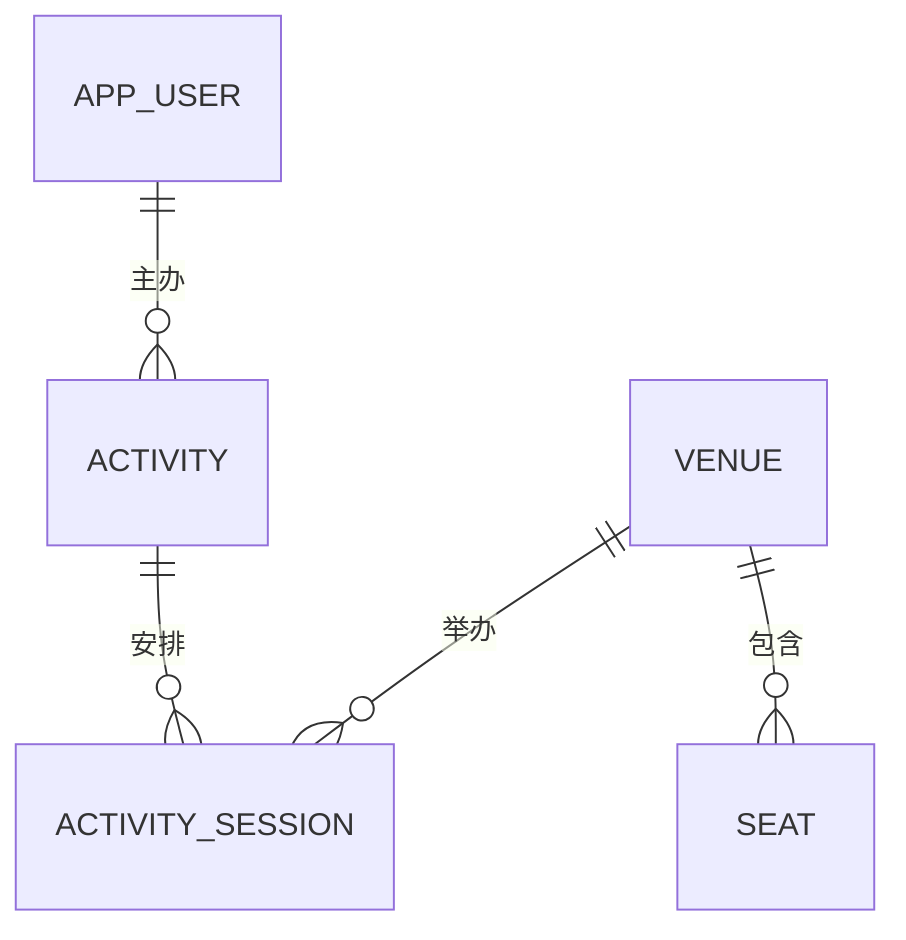

# 第一阶段：五张基础表

> 本章记录 001 版本的五张基础表；当前已扩展到九张业务表，订单阶段见 [第三阶段](03_booking_transactions.md)。

对应迁移：`migrations/001_core_tables.sql`。

## 关系与职责



- `app_user` 是用户资料，不是 PostgreSQL 的数据库登录账号。
- `seat` 是物理座位；价格、锁座订单和已售状态放在后续 `session_seat` 中。
- `activity` 是活动主题；具体时间和场馆放在 `activity_session` 中。

## 通用字段和约束

所有表的主键采用 `BIGINT GENERATED ALWAYS AS IDENTITY PRIMARY KEY`，插入时不用填写主键。
Identity 负责生成编号，主键负责唯一和非空；编号允许不连续，不用于计算业务数量。

所有表均有：

| 字段 | 类型 | 含义 |
|---|---|---|
| `created_at` | `TIMESTAMPTZ` | 创建时间，默认当前语句时间 |
| `updated_at` | `TIMESTAMPTZ` | 修改时间，通过更新触发器维护 |

`DEFAULT` 只提供插入时的默认值，不能独自实现更新时自动修改时间。
共享函数 `set_updated_at()` 被五个 `BEFORE UPDATE` 触发器调用。
后续数仓增量抽取还需设计水位、重叠读取或提交顺序处理，不能只凭一个修改时间就保证不漏数据。

## 用户 app_user

| 字段 | 类型 | 约束或默认值 |
|---|---|---|
| `user_id` | `BIGINT` | 自动生成主键 |
| `email` | `VARCHAR(254)` | 必填、非空白；去除首尾空格并转小写后唯一 |
| `display_name` | `VARCHAR(100)` | 必填、非空白 |
| `role` | `VARCHAR(20)` | `CUSTOMER` / `ORGANIZER` / `ADMIN`，默认 `CUSTOMER` |
| `status` | `VARCHAR(20)` | `ACTIVE` / `INACTIVE`，默认 `ACTIVE` |

唯一表达式索引 `ux_app_user_email` 防止同一邮箱仅改变大小写或增加首尾空格后再次注册。
此索引不会修改邮箱原文；规范化、邮箱格式和登录权限由后续应用处理。
本阶段没有密码字段，也没有实现用户登录认证。

## 场馆 venue

| 字段 | 类型 | 约束或默认值 |
|---|---|---|
| `venue_id` | `BIGINT` | 自动生成主键 |
| `name` | `VARCHAR(200)` | 必填、非空白 |
| `address` | `TEXT` | 必填、非空白 |
| `status` | `VARCHAR(20)` | `ACTIVE` / `INACTIVE`，默认 `ACTIVE` |

不同场馆允许同名，不把名称当作主键。场馆物理座位数量可从 seat 查询，避免再维护一份容量计数。

## 物理座位 seat

| 字段 | 类型 | 约束或默认值 |
|---|---|---|
| `seat_id` | `BIGINT` | 自动生成主键 |
| `venue_id` | `BIGINT` | 必填，外键关联 venue |
| `seat_code` | `VARCHAR(32)` | 如 A1；大写、无首尾空格、非空 |
| `row_label` | `VARCHAR(16)` | 如 A；大写、无首尾空格、非空 |
| `seat_number` | `INTEGER` | 正整数 |
| `status` | `VARCHAR(20)` | `ACTIVE` / `INACTIVE`，默认 `ACTIVE` |

- `UNIQUE (venue_id, seat_code)`：同一场馆的座位编号不重复，不同场馆允许各有 A1。
- `UNIQUE (venue_id, row_label, seat_number)`：不能给同一个位置换个编号后重复创建。
- 没有价格、AVAILABLE、LOCKED、SOLD 字段，这些属于某一场次的库存。

## 活动 activity

| 字段 | 类型 | 约束或默认值 |
|---|---|---|
| `activity_id` | `BIGINT` | 自动生成主键 |
| `title` | `VARCHAR(200)` | 必填、非空白 |
| `description` | `TEXT` | 必填，默认空字符串 |
| `organizer_id` | `BIGINT` | 必填，外键关联 app_user |
| `status` | `VARCHAR(20)` | `DRAFT` / `PUBLISHED` / `ARCHIVED`，默认 `DRAFT` |

外键保证主办用户存在。只有主办方或管理员能发布活动等权限，在后续应用层校验；当前数据库并未强制 organizer_id 对应某个特定 role。

## 场次 activity_session

| 字段 | 类型 | 约束或默认值 |
|---|---|---|
| `session_id` | `BIGINT` | 自动生成主键 |
| `activity_id` | `BIGINT` | 必填，外键关联 activity |
| `venue_id` | `BIGINT` | 必填，外键关联 venue |
| `start_time` | `TIMESTAMPTZ` | 必填，开始时间 |
| `end_time` | `TIMESTAMPTZ` | 必填，必须晚于开始时间 |
| `status` | `VARCHAR(20)` | `SCHEDULED` / `ON_SALE` / `CLOSED` / `CANCELLED` / `FINISHED`，默认 `SCHEDULED` |

`UNIQUE (activity_id, venue_id, start_time)` 防止重复配置同一活动、场馆和开始时间。
这项唯一约束不等于禁止所有场馆时间重叠；排期冲突、状态跳转和开售条件属于后续业务流程。
查询某活动或场馆的场次时，分别使用以 activity_id、venue_id 和 start_time 组成的索引。

## 删除策略

外键统一使用 `ON DELETE RESTRICT`，防止误删仍有关联记录的场馆、用户或活动。
业务停用优先通过状态表达，避免级联删除导致后续交易或分析失去来源。

## 在 VS Code 中查看和执行

1. 打开 `migrations/001_core_tables.sql`，先阅读 app_user 和 venue 两段。
2. 已安装的本地数据库已执行本迁移，不要再次执行建表脚本。
3. 新克隆项目且数据库没有这些表时，在 macOS / Linux 项目根目录执行一次：

```bash
docker compose up -d --wait --wait-timeout 120
docker compose exec -T postgres psql -X -U ticketing_admin -d ticketing -v ON_ERROR_STOP=1 < migrations/001_core_tables.sql
```

Windows PowerShell 等不支持该输入重定向方式的终端，可以先复制文件到容器再执行：

```bash
docker compose cp migrations/001_core_tables.sql postgres:/tmp/001_core_tables.sql
docker compose exec -T postgres psql -X -U ticketing_admin -d ticketing -v ON_ERROR_STOP=1 -f /tmp/001_core_tables.sql
```

账号与数据库名如有修改，替换命令中的对应值。文件通过事务创建整组表，失败时回滚；已创建的表不会被脚本删除或重建。
后续结构变化使用新的迁移文件，不直接修改已应用的 001 脚本来更新现有数据库。

### 查看结果

```bash
docker compose exec postgres psql -U ticketing_admin -d ticketing
```

进入 psql 后：

```text
\dt
\d app_user
\d seat
\q
```

### 运行约束验证

```bash
docker compose exec -T postgres psql -X -U ticketing_admin -d ticketing -v ON_ERROR_STOP=1 < tests/sql/001_core_tables.sql
```

验证覆盖：正常关联写入、跨场馆同名座位、同场馆重复编号、同位置重复座位、邮箱归一化唯一性、错误时间、外键、删除保护与更新触发器。
脚本打印 8 条 PASS，最终回滚验证数据。建议在开发库执行；测试所用邮箱 `schema-check@example.test` 需未被占用。
Identity 序列可能前进，测试后主键从较大的数字开始属于正常现象，不能据此认为有数据丢失。

## 本轮范围

当前仅建立五张基础表及其约束、索引和修改时间触发器。尚未实现锁座、防超卖、订单、支付、退款和电子票。

## 技术依据

- [PostgreSQL 17 约束](https://www.postgresql.org/docs/17/ddl-constraints.html)
- [PostgreSQL 17 Identity 列](https://www.postgresql.org/docs/17/ddl-identity-columns.html)
