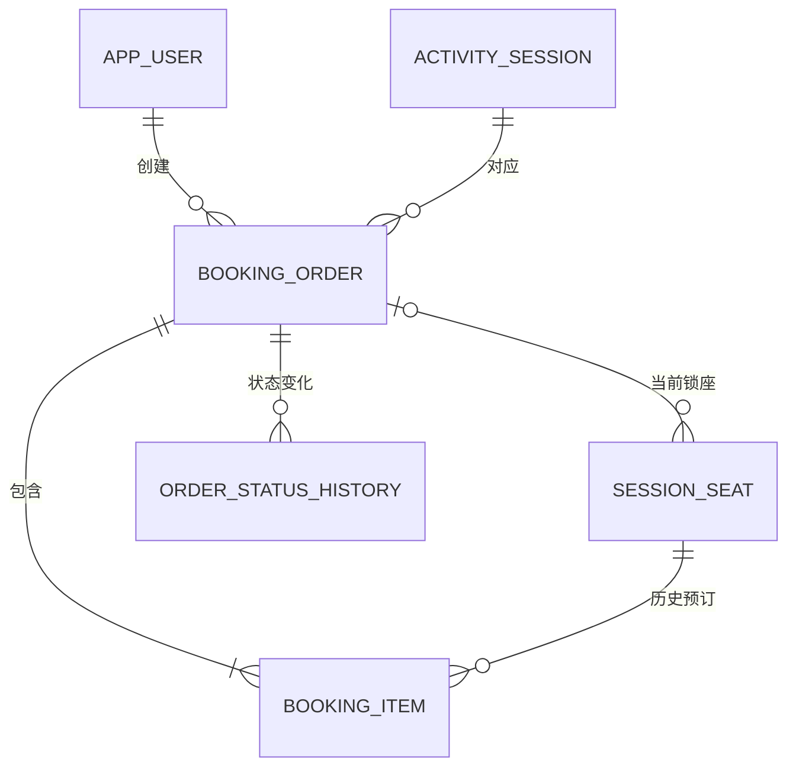

# 第三阶段：订单、锁座、取消与超时释放

本阶段形成可以运行的待支付交易流程；支付、售出、电子票和退款留在下一阶段。
入口为 Docker 中的 Python 命令行，之后 FastAPI 直接调用相同的 BookingService。

## 本轮新增内容

| 文件或目录 | 作用 |
|---|---|
| `migrations/003_booking_orders.sql` | 三张交易表、库存锁座字段和关联约束 |
| `ticketing/booking.py` | 下单、取消、查询、过期清理事务 |
| `ticketing/bootstrap.py` | 迁移登记、受限应用账号与可重复演示数据 |
| `ticketing/__main__.py` | 命令行入口与后台清理循环 |
| `tests/python/test_booking.py` | 独立测试库中的真实数据库集成与并发测试 |
| `Dockerfile`、`requirements.txt` | 固定版本的 Python 运行环境 |

现在有九张业务表，以及记录迁移版本的技术表 `schema_migration`。

## 表之间的关系



### booking_order

| 字段 | 含义 |
|---|---|
| `order_id` | 内部自动编号 |
| `order_no` | 对外展示的唯一订单号 |
| `user_id` | 买家 |
| `session_id` | 此订单对应的唯一场次 |
| `request_id` | 用户级幂等请求 UUID |
| `total_amount` | 明细价格合计，使用 NUMERIC(14,2) |
| `status` | PENDING / CANCELLED / EXPIRED |
| `expires_at` | 支付等待截止时间 |
| `created_at` / `updated_at` | 创建与修改时间 |

`UNIQUE(user_id, request_id)` 将网络重试识别为同一个请求。
同一个请求可以改变座位列表的排列顺序，但不能更换场次或座位集合。
原订单已取消或已过期时，同一 request_id 返回原订单；真正重新购买使用新的 request_id。

### booking_item

一行对应订单中的一个场次座位，主要字段：`item_id`、`order_id`、`session_id`、`session_seat_id`、`unit_price`、`created_at`。
两组组合外键保证订单、明细、库存属于同一个场次。
`unit_price` 是下单价格快照，后续修改库存当前价格不影响原订单。
同一订单不重复包含同一条库存；同一库存可以在取消后出现在另一个新订单的历史明细中。

### order_status_history

记录 `order_id`、`from_status`、`to_status`、`reason`、`actor_user_id` 和 `changed_at`。
创建记录为空状态到 PENDING；终态由 PENDING 到 CANCELLED 或 EXPIRED。
当前状态只进入一次，重复取消或清理不重复添加历史。

### session_seat 的新增字段

- `locked_order_id`：当前占用该库存的订单。
- `locked_until`：占用截止时间，与服务计算的订单截止时间保持一致。
- `status` 开放 AVAILABLE 和 LOCKED。

表内 CHECK 要求 AVAILABLE 的两个锁座字段均为空，LOCKED 的两个字段均非空。
组合外键要求锁座订单与库存属于同一场次，避免跨场次占用。

数据库负责主外键、唯一性、金额范围和锁座字段形态；订单总额与明细合计、完整状态流转、锁座截止时间同步由服务事务实现。
开发交易流程应调用 BookingService，不通过零散 UPDATE 绕过这些步骤。

## 下单事务如何执行

```text
检查用户和开售条件
    ↓
声明幂等请求键、创建待支付订单
    ↓
按库存编号排序，SELECT ... FOR UPDATE
    ↓
验证全部库存存在、属于指定场次、可售且物理座位启用
    ↓
重新读取数据库时钟，计算截止时间与金额
    ↓
写入价格快照明细、锁座信息和初始历史
    ↓
COMMIT；数据库行锁释放，业务 LOCKED 状态保留
```

在 Python 中，`with conn.transaction():` 退出时统一提交；抛出异常时统一回滚。
即便异常发生在明细和锁座更新之后，也不会留下部分订单或部分锁座。
每单 1～50 个不同库存编号；默认锁座 600 秒，且不超过场次开始时间。

## 两种“锁”为什么不同

| 机制 | 作用时间 | 目的 |
|---|---|---|
| PostgreSQL 行锁 | 下单事务执行期间 | 保护检查与修改不被并发请求穿插 |
| 库存 LOCKED 状态 | 提交后到付款等待期结束 | 持续表示座位属于哪个待支付订单 |

用户等待十分钟时不需要维持数据库事务或连接。
所有多座位请求按库存主键排序加锁；取消、释放统一按“订单 → 库存”顺序处理。
连接设置 5 秒锁等待上限和 30 秒语句上限；超时失败会回滚，调用方可以携带原 request_id 重试。

## 取消、清理与重复执行

取消先锁订单并检查买家；待支付且未过期时转为 CANCELLED，已经到期则转为 EXPIRED。
已是终态的订单直接返回当前结果，不再操作库存。
释放只更新 `locked_order_id` 仍属于本订单的行，清空占用字段并写入一条终态历史。

清理任务扫描已经过期的 PENDING 订单，使用 `FOR UPDATE SKIP LOCKED` 跳过其他任务正在处理的订单。
未过期订单不受影响。过期库存由清理任务或该订单的取消操作释放，下单本身不会偷偷重分配其他订单的锁座。
如果发现明细数量和实际占用库存不一致，任务回滚并报错，避免错误释放。

## 部署和迁移

更新 `.env` 时保留原数据库密码；新增 `TICKETING_APP_PASSWORD`（示例见 `.env.example`）。
本次本地安装已生成此配置，无需再复制覆盖 `.env`。

```bash
docker compose up -d --wait --wait-timeout 120 postgres
docker compose run --rm --build db-admin
docker compose run --rm db-admin demo
docker compose run --rm app catalog
```

`db-admin` 使用初始化管理员，只负责迁移和演示数据。
`app` 与 `reservation-worker` 使用 `ticketing_app`，只有查询、交易表插入、订单与库存更新及序列使用权限；没有建表和删除交易记录权限。
本阶段没有登录 API，命令行的 user 参数是本地演示的调用方身份，未来接入 API 时必须从认证上下文取得。

### 迁移版本记录

空库自动执行 001 → 002 → 003，并为每份文件保存 SHA-256。
已有本地库先核对已知 001/002 的字段、触发器和主要约束，登记它们已执行，再应用 003；不重建旧表或移动旧场次。
这是针对当前项目早期手工迁移的兼容路径，不是任意未知数据库的自动修复。
重复 init 跳过相同版本；修改已登记文件会报错，结构变化应新增迁移。
迁移和版本记录在同一个事务中提交，迁移间以数据库咨询锁串行化。

## 演示步骤

先看 `catalog` 中的 user_id、session_id 和 session_seat_id。
新演示使用两个普通用户、单独的已发布活动与未来开售场次，原来 10 月 30/31 日的历史场次保留。
重复 demo 复用仍在未来的演示场次，不重置已有订单、库存状态或票价；没有未来场次时新建未来七天的两场演出。
也可明确指定 `docker compose run --rm db-admin demo --start 2026-12-01T19:00:00+08:00`。

下方数字是占位示例，替换成你在 catalog 中看到的实际编号：

```bash
docker compose run --rm app reserve --user 你的用户编号 --session 你的场次编号 --seats 库存编号A 库存编号B
docker compose run --rm app order --user 你的用户编号 --order 返回的订单编号
docker compose run --rm app cancel --user 你的用户编号 --order 返回的订单编号
```

`--seats` 接收 session_seat_id，不是物理 seat_id。
需要验证请求重试时，首次和后续 reserve 使用同一 `--request-id` UUID。

快速演示超时可用 `reserve ... --hold-seconds 2`，然后运行一次清理或启动后台任务：

```bash
docker compose run --rm app expire
docker compose --profile workers up -d --build reservation-worker
docker compose logs --tail=20 reservation-worker
docker compose stop reservation-worker
```

后台任务每五秒执行一批清理，可同时运行多个清理实例；每批事务失败会回滚，记录错误类型后在下一轮重试。

## 测试与证据

```bash
docker compose run --rm --build tests
```

测试服务使用管理员创建随机命名的 `ticketing_test_*` 临时数据库，迁移后通过受限应用账号调用真实事务逻辑，结束后删除本次测试库。
业务库和既有记录不被清空。测试覆盖：

- 两座订单、价格快照、幂等重试与冲突请求。
- 部分库存不可用、事务末尾故障的完整回滚。
- 两个独立连接争抢座位，以及相同 request_id 的并发重试。
- 取消重试后不释放新订单的库存；其他用户不能读取消订单。
- 超时、未超时、取消与过期任务竞争、释放后重新下单。
- 开售与账户条件、跨场次关联和孤立锁座约束。
- CLI、后台任务单轮、受限数据库权限、迁移重跑、旧结构兼容、样例重跑。

并发测试先让第一个事务持有库存锁，随后启动第二个独立连接。
从 `pg_stat_activity` 和 `pg_blocking_pids()` 观察到第二个连接处于 Lock 等待后才提交第一个事务，避免把顺序请求当作并发实验。
同座位竞争最终一单成功、一单业务失败；相同请求并发最终返回同一个订单。
实测结果与日志见 `docs/verification/`。

## 当前边界

本阶段完成 PENDING、CANCELLED、EXPIRED。尚未实现支付、SOLD、电子票、退款或 HTTP API。
下一阶段增加支付事务，沿用当前价格快照、订单锁与幂等处理方式。

## 技术依据

- [PostgreSQL 17 行锁和一致加锁顺序](https://www.postgresql.org/docs/17/explicit-locking.html)
- [Psycopg 事务上下文](https://www.psycopg.org/psycopg3/docs/basic/transactions.html)
