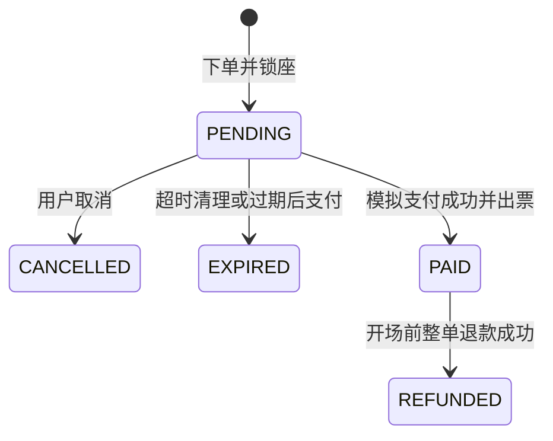

# 第四阶段：模拟支付、电子票与全额退款

对应迁移：`migrations/004_payment_refund.sql`。运行入口：`ticketing/payment.py`、`python -m ticketing`。

## 本阶段能做什么

待支付订单可以模拟付款成功或失败。成功后，每条订单明细生成一张电子票，库存进入已售状态。
开场前允许整单全额退款；成功后票失效，座位恢复可售，其他用户可以再次购买。
支付或退款失败只记录一次尝试，不改变订单、电子票和库存。

这是本地同步模拟：没有真实资金、支付平台、HTTP 回调、二维码或检票功能。
`--outcome` 仅用于教学演示，不能作为真实支付系统的付款凭据。
普通用户身份由 CLI 的 `--user` 指定，身份认证将在 API 阶段实现。

## 三组状态怎样配合



| 操作完成后 | 订单 | 库存 | 电子票 |
|---|---|---|---|
| 下单 | PENDING | LOCKED，记录订单和截止时间 | 无 |
| 支付失败 | PENDING | 仍然 LOCKED，原截止时间不延长 | 无 |
| 支付成功 | PAID | SOLD，记录已售订单，清空锁座字段 | 每个明细一张 VALID |
| 退款失败 | PAID | 仍然 SOLD | 仍然 VALID |
| 退款成功 | REFUNDED | AVAILABLE，清空已售订单 | REFUNDED，保留历史 |
| 取消或超时 | CANCELLED / EXPIRED | AVAILABLE | 无 |

已支付订单不能通过 `cancel` 释放座位，应使用 `refund`。
支付资格以取得订单、库存行锁后数据库实时时钟的判断为准；支付已取得资格并持锁时，清理任务跳过该订单。
如果支付等待行锁期间超过截止时间，则提交过期释放，返回 `payment: null` 和 `EXPIRED` 订单，不生成支付记录或票。
如果清理任务已经完成，新的支付请求会得到业务错误。

## 为什么新增三张表

| 表 | 记录内容 | 主要约束 |
|---|---|---|
| payment_attempt | 支付编号、订单、请求 UUID、金额、结果、时间 | 每单请求编号唯一，每单最多一次成功 |
| ticket | 票号、订单明细、库存、状态、签发和失效时间 | 每个明细一张票，每个库存最多一张有效票 |
| refund_attempt | 退款编号、原支付、金额、原因、请求 UUID、结果 | 每单请求编号唯一，每单最多一次成功 |

现在共有十二张业务表，另有 `schema_migration` 迁移登记表。
退款通过组合外键关联原支付的编号、订单和金额，保证金额等于原支付的全额。
支付和退款尝试对应用数据库账号只开放查询和插入，不允许修改或删除。
电子票通过组合外键绑定原订单明细和库存，退款后仍保留原票号及归属。
有效票的部分唯一索引允许同一座位在旧票退款失效后重新出票，避免出现两张有效票。

## 金额与幂等

下单时 `booking_item.unit_price` 和 `booking_order.total_amount` 已保存价格快照。
支付金额必须与订单总额完全一致；使用 `Decimal` 和数据库 `NUMERIC`，不使用浮点数计算金额。
退款金额从原成功支付记录读取，CLI 不接受自填退款金额。本阶段支持零金额订单。

建议每次新操作先生成 UUID，并在所有重试中保留它：

```bash
python -c 'import uuid; print(uuid.uuid4())'
```

同一订单、同一支付请求 UUID：金额和模拟结果相同则返回原支付；不同则报冲突。
同一订单、同一退款请求 UUID：原因和模拟结果相同则返回原退款；不同则报冲突。
支付和退款的请求编号分别独立。失败后想重新尝试，应使用新的 UUID。
成功后即使使用新 UUID，也不会再次支付或退款，而是报业务错误。
参数省略时会自动生成 UUID，返回的支付或退款记录中有 `request_id`；发生重试应复用该值。

旧支付成功后已退款，再重放原支付请求，会返回原支付记录以及当前 REFUNDED 订单，不会重新出票。
旧退款请求同样只返回原记录，不能释放后来订单占用或已售出的库存。

## 如何保证事务和并发正确

每次操作先 `SELECT ... FOR UPDATE` 锁订单，再按库存主键升序锁座位，最后锁电子票。
支付、退款、取消、超时清理共享这一锁顺序。
同一订单上的操作由订单行锁串行处理，不依赖 Python 进程内锁。
过期任务继续使用 `SKIP LOCKED`，可以跳过正在处理的订单。

支付记录、出票、库存已售、订单已支付和状态历史在同一数据库事务中提交。
退款记录、票失效、库存释放、订单已退款和历史也在同一事务中提交。
任一步失败，整笔事务回滚。数据库唯一约束作为重复支付、重复退款和重复出票的最后一道保护。
业务层同时检查库存仍归当前订单、票数量与状态完整，以及场次尚未开始。

注意：这里能使用一个短事务，是因为支付结果完全由本地模拟器产生。
以后接真实支付平台时，需要独立的支付单、验签回调、去重和对账，不能把外部网络请求直接塞进这个事务。

## 升级与演示

在仓库根目录执行，保留现有 `.env` 和 Docker 数据卷：

```bash
docker compose stop reservation-worker
docker compose run --rm --build db-admin
docker compose run --rm db-admin demo
docker compose --profile workers up -d --build reservation-worker
docker compose run --rm app catalog
```

004 新增字段、约束和表，不重建已有表；001～003 的文件保持原样。
`init` 同时授予应用账号新表所需权限。不要用 `down -v` 升级，那会删除数据库数据卷。

以下中文占位符都要替换成实际输出。先选同一未来场次的可售库存：

```bash
docker compose run --rm app reserve --user 用户编号 --session 场次编号 --seats 库存A 库存B
docker compose run --rm app pay --user 用户编号 --order 订单编号 --amount 订单总额 --request-id 支付UUID
docker compose run --rm app order --user 用户编号 --order 订单编号
docker compose run --rm app refund --user 用户编号 --order 订单编号 --reason "行程改变" --request-id 退款UUID
docker compose run --rm app order --user 用户编号 --order 订单编号
```

`order` 返回价格明细、状态历史、所有支付尝试、电子票及所有退款尝试。
用完全相同的参数再次执行 `pay` 或 `refund` 可以观察幂等返回。
模拟失败时，在相应命令后添加 `--outcome FAILED`；重新模拟成功需换新的请求 UUID。
CLI 在模拟失败已成功记录时返回退出码 0，应查看 `payment.status` 或 `refund.status` 判断业务结果。
参数、权限、状态等业务错误返回退出码 1。

退款成功后，可以让另一个用户购买相同的库存，再查询原订单验证旧票保持 REFUNDED。
CLI 仅展示票记录；检票与核销不在本阶段范围。

## 验证

```bash
docker compose run --rm --build tests
```

集成测试创建独立 `ticketing_test_*` 数据库，包含空库建表和 003 版本带订单升级两种路径。
覆盖支付成功、失败、金额校验、用户归属、幂等、出票、退款失败及成功、开场限制、重售、故障回滚和数据库权限。
并发测试使用两个真实数据库连接，观察 `pg_stat_activity` 的 Lock 等待和阻塞者编号。
测试结束只清理临时测试库，开发库中的历史订单保留。

本机验证记录见 [第四阶段验证](../verification/stage4.md)。
