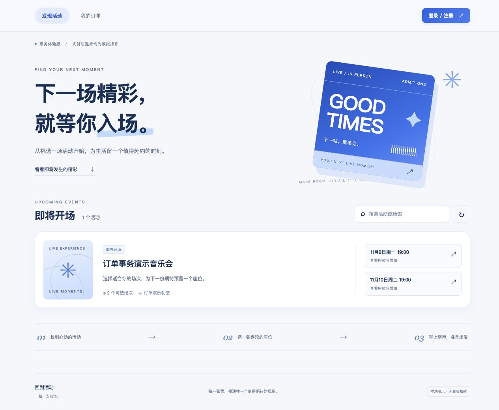

# 第六阶段验证记录

验证日期：2026-11-02。平台：macOS / Apple Silicon，PostgreSQL 17.11、Python 3.12.16。

## 自动化验证

- Docker 镜像：57 项数据库、交易、认证、接口和页面入口测试全部通过，耗时 15.187 秒。
- 项目 Conda 环境：同样 57 项测试全部通过，耗时 16.566 秒。
- Node.js：7 项前端逻辑测试通过；app.js 语法检查通过。
- 金额按分精确汇总，覆盖小数及大金额；非法金额被拒绝。
- 同一动作的未确认请求复用原 UUID，内容变化或确认后分配新 UUID。
- 外部文本 HTML 转义与跨时区倒计时测试通过。
- 根路径和静态资源正常；API、Swagger 和认证路径保持独立；越界静态路径不能读取 Python 源码。
- 页面响应含 CSP、nosniff 和同源引用策略；旧 logo 资源已经移除。
- 订单在活动下架后仍能查询活动名称、场馆、开场时间和座位信息。

日志：[Docker](stage6-tests.txt)、[Conda](stage6-conda-tests.txt)、[前端逻辑](stage6-js-tests.txt)。

## 浏览器实际操作

使用本地独立演示账号，实际验证了：

1. 错误密码保留可见错误提示，正确密码登录成功。
2. 选择场次 13 的 A1、A2 两个座位，合计为 220.00。
3. 创建订单 9，显示倒计时；修正下单后的按钮恢复问题后，新订单按钮立即可用。
4. 模拟支付成功，看到两张有效电子票以及订单状态历史。
5. 整单全额退款成功，订单 9 为 REFUNDED，两张票失效。
6. 手机布局重新选择 A1 创建订单 10，取消后状态为 CANCELLED。
7. 订单状态筛选、活动搜索无结果、退出后隐藏个人订单正常。
8. 桌面 1280、手机 390 和窄屏 320 宽度实测，无横向溢出。
9. 最终页面采用蓝色主题，已移除品牌名称和 logo。

最终库存 19、20 均为 AVAILABLE，锁座及已售归属清空；本次验证账号的会话全部撤销。
数据库迁移版本仍为 5，没有新增或修改迁移；未遗留临时测试库。
最终快照：[浏览器验证结果](stage6-browser.json)。

## 使用

打开 `http://127.0.0.1:8000/`，无需手填用户编号、库存编号或请求 UUID。
前端无构建步骤，随既有 API 镜像部署。登录只保留在当前页面内存，刷新后需要重新登录。
当前为本地演示，支付退款不产生真实资金，未加入检票和管理后台。
操作步骤与分支依赖见 [网页使用说明](../web/06_web.md)。
