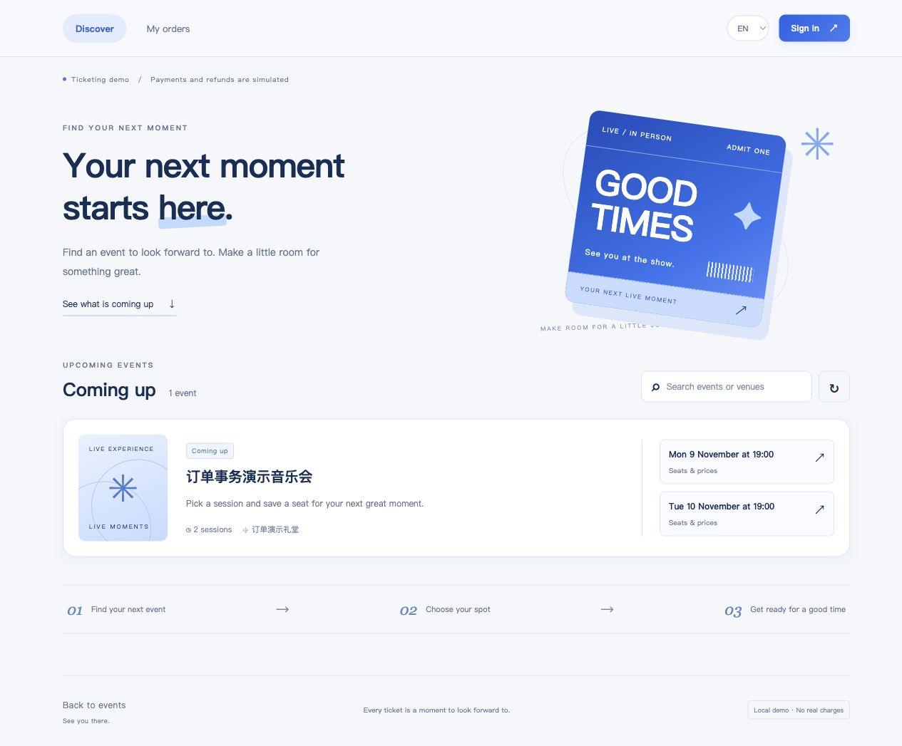

# 轻量前端三语切换验证

验证日期：2026-11-02。分支：codex/web。

## 功能

- 页面右上角支持简体中文、繁體中文、English；登录、选座、订单详情与操作确认弹窗内也可切换。
- 导航、表单标签、占位提示、无结果状态、订单状态、电子票、订单历史和前端错误提示随语言更新。
- 日期按中文或英文格式显示，真实时刻仍使用 Asia/Shanghai；币种保持人民币，不进行汇率转换。
- 英文数量区分单复数，如 1 event、2 sessions、2 tickets。
- 浏览器仅保存 ticketing.language 语言偏好。登录令牌仍只保存在页面内存，不写入浏览器存储。
- 存储禁用或偏好值无效时安全退回简体；当前页面仍可正常切换。
- 切换不提交业务操作，也不清空已选座位、表单输入或退款原因。
- 活动名称、场馆、描述、用户名及用户输入保持数据库或用户原文，不进行自动翻译。

## 自动化测试

- 15 项 Node 前端测试通过，涵盖词典完整性、全部界面原文登记、占位符、语言持久化、存储失败、日期、单复数和错误翻译，另保留金额与请求幂等测试。
- 57 项 Docker/PostgreSQL 集成测试通过，包含三语资源可访问性，以及既有交易、认证和权限回归。
- JavaScript 语法检查与 git diff --check 通过。

日志：[前端测试](web-i18n-js-tests.txt)、[API 回归](web-i18n-api-tests.txt)。

## 浏览器实测

1. 简体首页切换 English，刷新后仍保持 English。
2. 切换繁体，导航、场次日期、选座提示同步显示繁体。
3. 繁体选择 A1 后，在选座弹窗切换英文，A1 仍被选中，金额保持 ¥100.00。
4. 英文登录失败提示正确；在登录弹窗切换繁体后错误提示更新，表单内容未清空。
5. 使用既有本地演示账号登录，取消及退款订单以英文或繁体显示；电子票与历史状态翻译正确。
6. 英文 320 窄屏与桌面 1280 布局检查通过，无横向溢出；测试后恢复正常窗口尺寸。
7. 验证账号主动退出；本轮没有新增购票订单，也未改变数据库结构。
8. 页面最终恢复简体，用户可以自行切换并记住自己的选择。



复现：

```bash
node --test tests/js/web.test.mjs tests/js/i18n.test.mjs
docker compose run --rm --build tests
```
